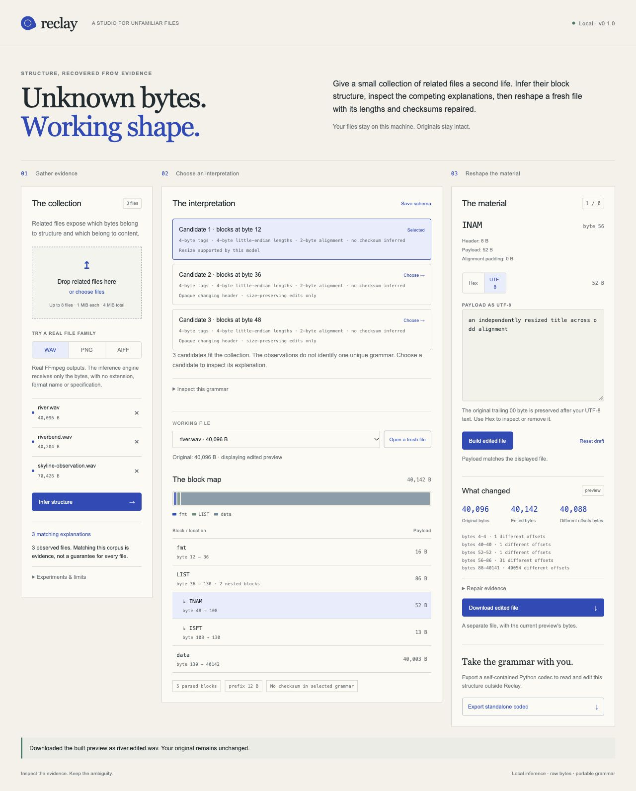

# Reclay

**Turn examples of a binary format into a standalone editor.**

Give Reclay related files. It searches for rules governing tagged blocks, their lengths, padding and checksums, then compiles the surviving model into a dependency-free Python codec. Inspect a fresh file, resize a block, and watch its enclosing sizes, later positions and checksums change. Keep opaque payloads and original padding intact when they are untouched.

The learner receives bytes only. It does not use extensions, format names, magic-signature databases, an LLM, a supplied specification or the generating application's source.



## Run locally

Python 3.10 or later, no runtime dependencies:

```sh
python3 -m pip install ./reclay-0.1.0-py3-none-any.whl
reclay serve
```

Open the printed loopback address. Load the WAVE, PNG or AIFF observations, infer a model, inspect a block and preview a replacement before downloading it. Your originals are never rewritten. You can also supply your own related files. Ambiguous observations retain their competing explanations; selecting one is an explicit assumption.

From source:

```sh
python3 -m reclay serve
python3 -m unittest discover -s tests -v
```

## What an example proves

The WAVE demonstration contains real FFmpeg-produced files with varying metadata and audio lengths. Change a title to a longer, previously unseen value. Reclay discovers the nested block structure and rebuilds the inner length, padding, enclosing block and outer file length. An independent FFmpeg output with that title is the byte oracle; decoding verifies that the audio remains unchanged.

PNG and AIFF give different structural families: length before identifier with CRC32, versus big-endian identifier before length with aligned blocks. Checks use fresh held-out files and actual independent decoders. These examples exercise the inference mechanism; they are not installed format templates.

## Evidence, assumptions and limits

Reclay searches a declared family of tagged, length-delimited binary layouts. The inference result records source hashes, surviving rules and experiment suggestions. Model hashes identify the exact rule configuration; they are not signatures or authentication of the claimed corpus. Exact round trips establish preservation for those observations. They do not establish the intended meaning of an unknown block, the validity of arbitrary replacements or a complete specification.

Encrypted/compressed payload semantics, arbitrary pointer graphs, bit-packed fields, changing-width object tables and native application behavior are outside this first release. An opaque block stays opaque. A structurally valid file can still be rejected by its original application. Keep that distinction when editing image data, audio headers or unknown application state.

There is no universal format recovery or automatic repair of arbitrary corruption. Contradictory observations, damaged checksums, excessive sizes and unsupported structures are rejected. Boundary experiments matter: short even-length samples cannot distinguish every padding or integer-width rule.

## Prior work

Binary format inference, grammar learning and generated editors have substantial prior work. [Kaitai Struct](https://doc.kaitai.io/serialization.html) already generates reading and writing code from supplied specifications. [ImHex](https://github.com/WerWolv/ImHex/releases) supports pattern-based save editors. [Netzob](https://netzob.github.io/netzob/index.html) supports protocol inference and relationship fields including sizes, padding and CRC32. [BinPRE](https://github.com/ecnusse/BinPRE) recovers protocol fields using executable instrumentation. [FormatFuzzer](https://github.com/uds-se/FormatFuzzer) compiles supplied templates into parsers and generators.

Reclay's contribution is a small complete local workflow: retain alternative rules from raw observations, make the uncertainty actionable, edit supported nested layouts losslessly, and take the inferred codec away as ordinary standalone code. It does not claim the invention of format inference or maintainer endorsement.

The included files were generated for this project by FFmpeg, using deterministic synthetic signals and images. `reclay/examples/manifest.json` records the producer, commands, hashes and held-out identities. No third-party source is embedded in the runtime. Original product code is MIT licensed. Developed and reviewed with Codex.

## Terminal workflow

```sh
reclay infer sample-a.bin sample-b.bin sample-c.bin --out learned.reclay
reclay inspect --schema learned.reclay --model MODEL_ID fresh.bin
reclay edit --schema learned.reclay --model MODEL_ID fresh.bin \
  --path 1/0 --payload replacement.bin --out edited.bin
reclay export --schema learned.reclay --model MODEL_ID --out codec.py
```

Use the studio or the JSON schema to select an actual model ID. A model with unexplained changing prefix bytes refuses size changes. The CLI refuses ambiguous implicit selection and refuses to overwrite an existing output.

The exported codec runs without Reclay installed:

```sh
python3 codec.py inspect fresh.bin
python3 codec.py rebuild fresh.bin edits.json edited.bin
```

The edits file is a list such as `[{"path":[1,0],"payloadHex":"726976657200"}]`. Paths are zero-based; only leaf payloads can be replaced. Changing a known block's interpretation is still your responsibility.

To regenerate the corpus with the recorded FFmpeg version, run `python3 scripts/generate_examples.py`. Generated signals are synthetic and owned; the manifest distinguishes training files from withheld reference files.
