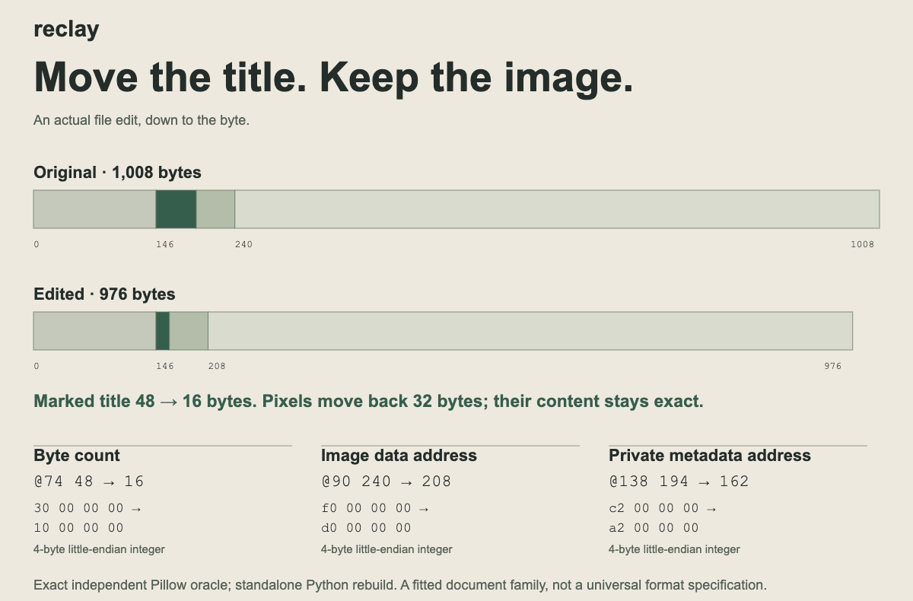

# Three rewrites. One intact image.

Reclay learned one bounded document family from eight related, independently generated TIFF observations and supplied matching spans. This actual current-source run shrank the withheld working file's title, rewrote its byte count and two distant addresses, and preserved the remaining envelope. No TIFF specification or tag names were learner inputs.



[Try the browser experiment](https://nazeeh111.github.io/Reclay/relocation.html) · [Actual desktop workspace](workbench.png) · [Phone workspace](workbench-mobile.png) · [Complete executable example](worked-example.zip)

## Observations support a hypothesis

The fixture is original synthetic 32×24 grayscale data and invented ASCII metadata, produced with Pillow 12.3.0. Eight observations include odd/even title lengths, a five-byte boundary case and a 70 KiB title. The learner receives only bytes and explicitly supplied inclusive-start/exclusive-end spans. The original producer, commands, hashes and held-out oracle are in the [source manifest](../../reclay/examples/relocation/manifest.json).

The first three short observations retained 48 competing interpretations. All eight retained one nontruncated model within the declared search family. This does not establish universal uniqueness, complete semantics, or confidence in an arbitrary unknown file. Missing/unvaried dependencies can remain invisible. The selected model covers one marked span and an invariant document envelope, not arbitrary TIFF images.

Current source parent is `9d4b6b008c6474afd4bc91a1ab19de36c15b9106`. [Exact CLI outputs, model and receipt](journey.json), [learned ensemble](learned.json), and [selected saved model](browser-model.json) preserve that identity and scope.

## Inspect every changed integer

The actual [working file](working.tif) has 1,008 bytes and a 48-byte marked title `[146,194)`, including its NUL terminator. The [replacement](replacement.bin) has 16 bytes. The resulting [separate edited file](edited.tif) has 976 bytes and title `[146,162)`.

- Offset 74: four-byte little-endian count `30 00 00 00 → 10 00 00 00` (48→16).
- Offset 90: four-byte address `f0 00 00 00 → d0 00 00 00` (240→208).
- Offset 138: four-byte address `c2 00 00 00 → a2 00 00 00` (194→162).

The learner calls the latter two fields absolute suffix pointers. Their image-data and private-metadata meanings were established separately with an independent reader, not inferred as semantic TIFF tags. The figure's common byte scale and raw words come directly from these files. [Editable SVG](byte-connections.svg), [phone SVG](byte-connections-mobile.svg), [standard-library generator](figure.py).

The CLI and actual browser download both match the independently produced Pillow oracle **byte for byte**. Pillow 13 independently reopened both original and edited TIFFs. All 768 decoded pixel bytes retained SHA256 `b6d384dc05b09586e4aa5308ce4beebb4a7aade32516091908ceab6ab82eecdb`; the private metadata string remained exact. [Decoder record](decoded.json). Byte-oracle agreement is evidence for this edit, not automatic acceptance by every original application.

## Take the editor with you

The actual browser downloaded the selected model, edited file and [standalone Python editor](editor.py). In a fresh directory, isolated Python `-I` ran that editor without Reclay installed and reproduced the exact oracle. A changed opaque pixel was refused with `family-guard`, without writing an output. Shortening below the observed five-byte floor also refused; the browser disabled the download and **Restore current span** recovered exact original bytes.

After extracting the [complete ZIP](worked-example.zip) into a fresh directory:

```sh
python3 -I editor.py rebuild working.tif replacement.bin rebuilt.tif --start 146 --end 194
```

Its manifest includes every required member. The bundle was extracted, every hash checked and its exported editor executed. Originals are separate and never overwritten.

In a fresh browser context, **Open saved model**, **Choose a working file**, mark 146–194 and **Inspect span** reopened the exact working bytes. A model does not embed the original file. Saving it is not saving an authenticated corpus or entire workspace history.

## One concrete product repair

Importing a syntactically valid but unsupported model previously replaced the valid selection before server rejection. The current candidate validates the import with the existing engine export validator **before** committing it. Refused imports now retain the valid model, editable draft and preview. A revision guard also prevents a delayed import from replacing a workspace changed during validation. This adds no inference rule or format support.

The actual browser repeats keyboard-triggered inference, edit/download, negative replacement, restore, invalid import preservation and fresh-context reopen. Desktop 1440×1100 and phone 390×844 captures retain the product's own paper/green identity; the phone has no horizontal overflow. Controller tests cover rejected-import preservation and delayed-response exclusion.

## Scope and provenance

This local run uses standard-library Python 3.13.11 and Chrome, with an existing Pillow 13 environment only for independent decoding. No model, provider, unknown executable, private binary, new dependency install or paid service was used. The browser laboratory's Pyodide deployment path is a separate existing runtime with its own first-download/network limits; it was rebuilt, not presented as a fresh end-to-end Pyodide acceptance run.

The separately held engineering branch's tagged-block holdout validation and saved-record UI are not merged or claimed here. Existing WAVE/PNG/AIFF examples, source APIs, ambiguity handling, size limits, checksums and documentation remain intact. This pointer case does not claim a checksum update. Relative pointers, cycles, compressed semantics, arbitrary pointer graphs and automatic field meaning remain outside scope. [Complete product docs](../../README.md), [relocation scope](../relocation-validation.md), [browser boundaries](../browser-lab.md). Original code/data/assets MIT; optional dependencies retain their licenses.
